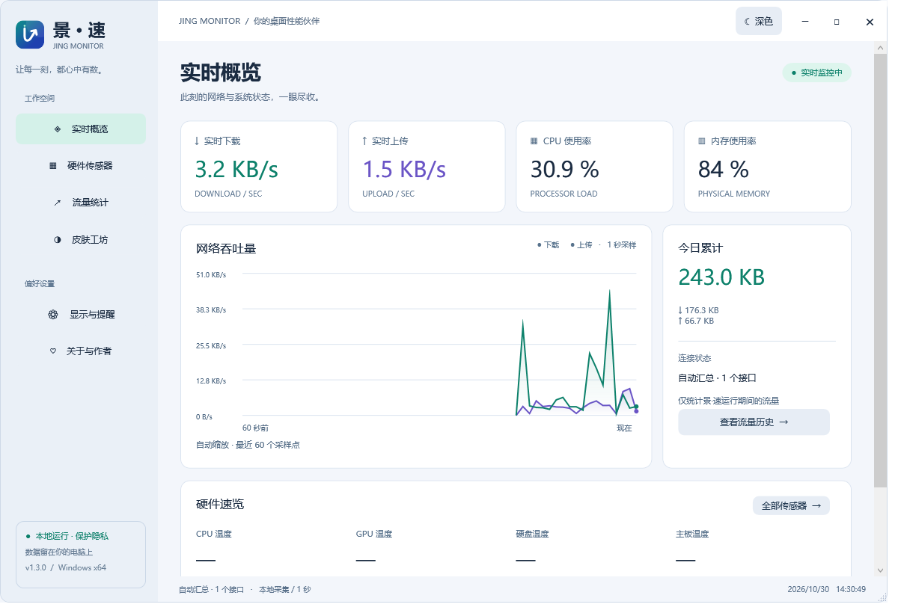
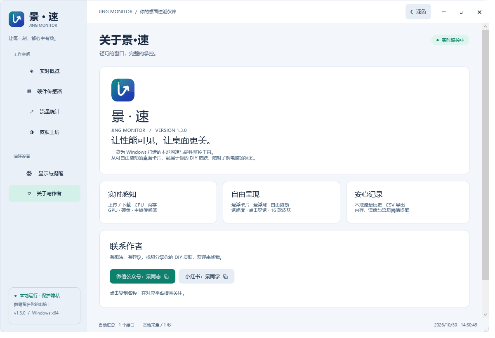
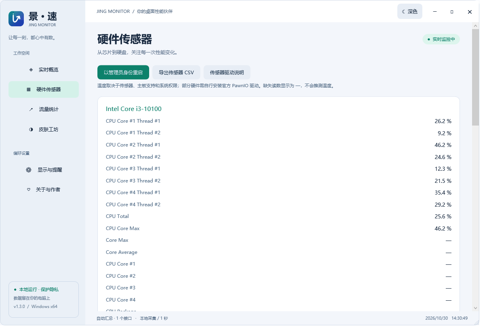
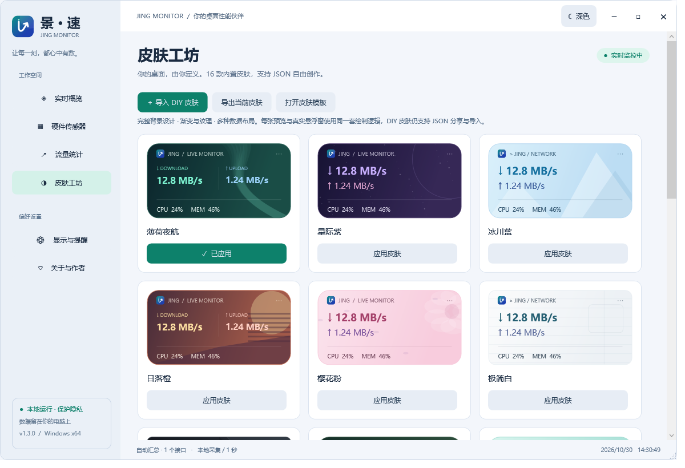
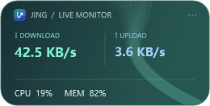
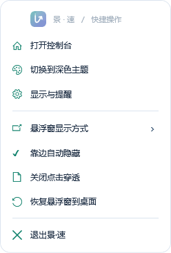

# 景·速 Jing Monitor

<p align="center">
  
</p>

> 一款为 Windows 打造的**本地网速与硬件监控**桌面悬浮工具 —— 让性能可见，让桌面更美。

[](https://github.com/jingpanlong/JingMonitor/releases)
[](LICENSE.txt)
[](https://github.com/jingpanlong/JingMonitor/releases)

**景·速 Jing Monitor** 是一个独立桌面悬浮窗程序，常驻桌面角落，实时显示网速、CPU、内存、GPU、硬盘与主板传感器数据。它不侵入任务栏，不依赖在线服务，所有数据均在本地采集与存储。

---

## ✨ 功能特性

- **实时感知**：每秒采集真实网速、CPU、物理内存；硬件温度与 GPU 数据通过 LibreHardwareMonitor 获取（无传感器数据时明确显示“不可用”，绝不伪造数值）。
- **自由呈现**：悬浮卡片 / 悬浮球两种形态，自由拖动；支持透明度、置顶、点击穿透、靠边自动隐藏（四边提手）。
- **16 款内置皮肤**：薄荷夜航、星际紫、冰川蓝、日落橙、樱花粉、极简白…… 不同渐变背景、装饰纹理与数据排版，皮肤工坊与悬浮窗共用同一矢量渲染器，**背景无需下载图片**。
- **DIY 皮肤**：导出 JSON 模板，编辑后导入即可分享给其他人。
- **安心记录**：本地日流量历史、CSV 导出、内存 / 温度 / 日流量阈值提醒（同类提醒最多每 5 分钟一次）。
- **轻量零依赖**：无需预装 .NET，自包含单文件运行。

---

## 📸 界面预览

| 控制台总览 | 关于与作者 |
| --- | --- |
|  |  |

| 硬件传感器 | 皮肤工坊 |
| --- | --- |
|  |  |

| 桌面悬浮卡片 | 系统托盘菜单 |
| --- | --- |
|  |  |

---

## 📥 下载

前往 **[Releases](https://github.com/jingpanlong/JingMonitor/releases)** 获取安装包：

- **JingMonitor-Setup-x.y.z.exe** —— 安装版（推荐），自动写入开始菜单、卸载项。
- **JingMonitor-x.y.z.exe** —— 单文件版，解压即用，无需安装；但开启“开机启动”后请勿移动该文件位置。

> ⚠️ 程序未做代码签名（EXE 未签名）。Windows SmartScreen 可能提示“未知发布者”，选择“仍要运行”即可。

---

## 🚀 快速上手

1. 先从系统托盘退出旧版本（若有），再运行 `JingMonitor-x.y.z.exe` 或用新版安装程序安装。
2. **按住悬浮窗拖动**即可移动；**双击**打开控制台；**右键**可锁定位置或恢复窗口。
3. 位置自动保存；松开鼠标后窗口保持在可见工作区内，自动避开任务栏。
4. 控制台「显示与提醒」可切换悬浮卡片 / 悬浮球，调节透明度、置顶、点击穿透与位置锁定。
5. 点击穿透后，请从系统托盘菜单关闭，或选择“恢复监控窗到桌面”。
6. 右上角 **×** 收起到托盘；完全退出请使用托盘菜单。

---

## 🎨 皮肤与 DIY

内置 16 款皮肤，覆盖多种渐变背景与布局：

> 薄荷夜航 · 星际紫 · 冰川蓝 · 日落橙 · 樱花粉 · 极简白 · 曜石黑 · 森林绿 · 海盐青 · 琥珀 · 霓虹 · 雾霾蓝 · 奶油 · 葡萄 · 深海 · 玫瑰

**DIY 方式**：在皮肤工坊导出 JSON 模板，编辑后导入，即可分享给他人。

字段说明：

- `Name` 为唯一名称。
- `Background` / `Background2` 为渐变背景两端颜色；`Border` 为描边；`Foreground` / `Accent` / `Upload` 为信息配色。
- `Pattern` 可选：`aurora, stars, glacier, sunset, petals, paper, facets, mountains, waves, honeycomb, grid, clouds, linen, orbits, sonar, bloom`。
- `Layout` 可选：`split`（双栏）、`stack`（纵向）、`terminal`（仪表）。
- `Radius` 为圆角（0–50），`FontSize` 为字号（10–24）；`ShowCpu` / `ShowMemory` 控制系统指标。
- 颜色使用 `#RRGGBB` 或 `#AARRGGBB`；文件不超过 64 KB；**不执行任何脚本**。
- 旧版 JSON 皮肤仍可导入，新增字段使用默认值。预览使用示例数据，悬浮窗使用实时数据。

---

## 🔒 数据与隐私

- 数据目录：`%LOCALAPPDATA%\JingMonitor`
  - `settings.json` / `traffic.json` / `skins.json` / `diagnostic.log`
- **不上传任何监控数据**。卸载时保留个人设置、流量与 DIY 皮肤。
- 硬件初始化与网络采集相互独立；部分硬件温度需管理员权限及 PawnIO 驱动。程序**不会自动安装驱动或修改系统安全设置**。
- 当前版本**没有在线皮肤市场**，通过 JSON 文件手动分享与导入。
- 流量仅记录程序运行期间；虚拟网卡可能重复计数，建议选择实际物理网卡。

---

## 🛠 构建与测试

需要 **.NET 8 SDK x64**。在源码根目录运行：

```powershell
.\build.ps1
```

输出位于 `dist/`：

- 单文件版：`dist/JingMonitor.exe`
- 安装版：`dist/JingMonitor-Setup.exe`（安装器使用 Windows .NET Framework 的 `csc` 编译，无需额外依赖）

自测命令（构建后）：

```text
JingMonitor.exe --self-test     # 网络、存储、皮肤及慢硬件初始化回归
JingMonitor.exe --smoke-test    # 独立测试数据目录，截图各页面/皮肤/悬浮窗后退出
JingMonitor-Setup.exe --verify <目录>   # 仅提取安装器资源校验，不执行真实安装
```

第三方库许可证见 `THIRD-PARTY-NOTICES.txt` 与 `licenses/`；应用与安装器源码许可证见 `LICENSE.txt`（MIT）。

> 开发提示：`Brand.cs` 是 Logo 的绘制源。编译后可运行
> `JingMonitor.exe --export-brand <源码中的 JingMonitor 目录>`
> 更新 `app.ico` 与 `logo.png` 后重新编译，使 EXE / 安装器图标与运行时 Logo 一致。

---

## 📂 目录结构

```text
JingMonitor-source/
├─ JingMonitor/        # 主程序（WPF / C#，net8.0-windows）
│  ├─ MainWindow.xaml(.cs)
│  ├─ Brand.cs         # Logo 矢量绘制源
│  ├─ Monitor.cs / MonitorFace.cs
│  ├─ Theme.cs / ThemeResources.cs
│  └─ ...
├─ installer/          # Setup.cs / Uninstall.cs（.NET Framework csc 编译）
├─ licenses/           # 第三方库 nuspec 与许可证
├─ build.ps1           # 一键构建脚本
├─ README.md           # 本文件
├─ README.txt          # 随安装包分发的说明
├─ LICENSE.txt         # 应用源码许可证（MIT）
└─ THIRD-PARTY-NOTICES.txt
```

---

## 📜 开源协议

- 应用与安装器源码：**[MIT License](LICENSE.txt)**
- 第三方库（LibreHardwareMonitor、.NET Runtime 等）保留其各自许可证，详见 [THIRD-PARTY-NOTICES.txt](THIRD-PARTY-NOTICES.txt) 与 `licenses/`。

---

## 💬 联系与反馈

- **GitHub**：[jingpanlong/JingMonitor](https://github.com/jingpanlong/JingMonitor) —— 查看源码、提交 Issue、下载安装包。
- 微信公众号：**景同志**
- 小红书：**景同学**

有建议、想反馈问题，或想分享你的 DIY 皮肤，欢迎通过以上渠道找到我。
